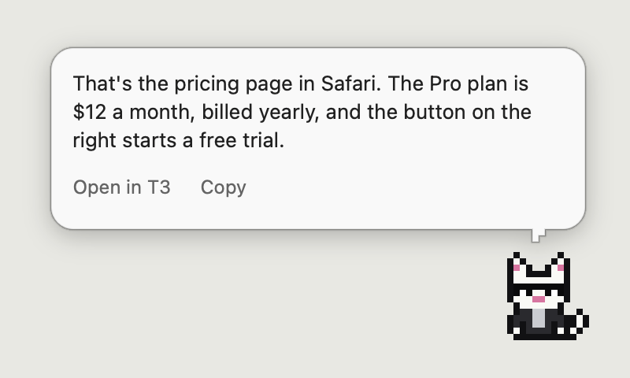

# Kitty Litter

The home of Shades, a cat in sunglasses that lives on your Mac. Ask it about whatever's on your screen, point at something broken and have an agent fix it, and keep an eye on your agents without switching windows.



It's early, and it runs its agents through [T3 Code](https://t3.codes), so you'll need that running.

## What it does

**Ask.** Press ⌥Space or click the cat, and ask anything. It looks at your screen at that moment and answers in a bubble, usually in about 10 seconds, though a model can occasionally take much longer. Good for "how do I start problem 3?" or "what does this error mean?"

**Fix what I'm looking at.** Press ⌃⌥F and drag a box around whatever's wrong. Say what's wrong, or just press Return. A frontier agent works out which of your projects it is, and fixes it in its own worktree, so your checkout stays untouched.

**Talk and dictate.** Hold right Option to talk to the cat. Hold Fn to dictate into any app, and your rambling comes out as clean text: fillers gone, self-corrections applied. Speech recognition and cleanup both run on your Mac.

**Watch your agents.** The cat sleeps when nothing's running, and is up and about when agents are working. When a session ends, it tells you how it went in two or three sentences. When an agent has a question, it shows you the question and your options. When one needs permission, the cat comes over with the exact command, so you can allow or deny it without leaving what you're doing. Shift-click the cat to see all your kittens and which are working, need you or are idle. A kitten can keep its reports in one inbox instead: what shipped, what you need to decide, and a way to reply to any of it.

**Messages.** Choose Messages from the cat's menu for one window with everything your kittens need from you, so you rarely have to open T3. **Needs you** is pinned at the top: approvals, questions, reports waiting on a decision, what shipped, and what each kitten is on. **Everyone** is a group chat with all your kittens. What you type there goes through the router, the same as the Ask box, and whoever takes it answers as itself. Each kitten has a conversation of its own, where you carry on its latest thread or start a new topic, answer what it's asking, and see a dot when it's finished something you haven't read. Nothing typed in Messages looks at your screen, and the window never shows up in a screenshot.


## How the work gets routed

There's no list of projects to maintain. Shades acts as one router in front of your agents. Everything you say goes to one model that can see your kittens and your recent T3 sessions, and it does one of four things:

- **Answers** if it can.
- **Sends it to a session** if it carries on from one, such as a follow-up to what Opus just reported. Your exact words go there, never a paraphrase, and that session keeps its own model and permissions.
- **Gives it to a kitten** if it's in a specialist's area.
- **Starts new work** if nothing has the context, saying so as it does. Fix always starts new work.

Agents with full access get your words but not your screen, so text on a page can't reach an agent that's allowed to do anything.

The frontier agent starts with no project, and finds the right one from what you said and what's on your screen, reading READMEs when a project's name isn't its folder name. For code changes it starts a new thread in that project's worktree. Research and questions it just answers.

The models are settings you can change. Opus 5.5 on xHigh is the default for both the front door and real work, and GPT-6.1 Sol on low writes the summaries.

## Install

You need an Apple Silicon Mac on macOS 14 or later, Xcode 16 or later, and T3 Code running.

```bash
git clone https://github.com/rohankumarrrr/kitty-litter
cd kitty-litter
scripts/make-dev-cert.sh   # see below
scripts/install.sh
```

The first launch does a few things:

- **Asks for permissions:** Screen Recording, Accessibility, Input Monitoring, the microphone, and scripting your browser. Turn them on, then choose **Restart** from the cat's menu.
- **Connects to T3 Code** by itself, with nothing to click.
- **Downloads about 1.2 GB of speech models.** The cat shows the progress. Asking by typing works in the meantime.

macOS ties permissions to an app's signature. Without a signing certificate, every rebuild has a new signature, so macOS forgets them. `scripts/make-dev-cert.sh` makes a local self-signed certificate that fixes this, and adds it to your keychain, so read the script first. When macOS asks whether codesign can use the key, choose **Always Allow**. `scripts/install.sh` won't replace a working app with an ad hoc build unless you pass `--ad-hoc`.

Two settings are worth changing:

- **To dictate with Fn:** set **System Settings > Keyboard > Press 🌐 key to** to **Do Nothing**. Otherwise macOS can act on the key too. You can also pick another key in Settings.
- **To read page text in your browser:** turn on **View > Developer > Allow JavaScript from Apple Events**. Without it, the cat still gets the address and a screenshot.

To see it without T3, permissions or a microphone, run `swift run shades --demo`.

## Privacy

- **It looks only when you ask:** pressing a key or clicking the cat takes one snapshot. Nothing runs in the background.
- **What leaves your Mac:** your question, a screenshot, the app and window names, the address, and any selected or page text go to the model you've chosen, through T3 Code. T3 Code keeps them with the thread. Your voice stays on your Mac, and only the resulting text is sent. When a session ends, its final report goes to the summary model, which may be a different provider from the one that ran the session.
- **Private apps stay private:** password managers are on a list you can edit, and incognito windows in Chromium browsers are skipped. Nothing is captured while they're in front. Background windows can still show up in a screenshot, and Safari's private windows mostly can't be detected.
- **Screen text is treated as data:** the agents are told it's never instructions, and they run in T3's `auto` mode rather than with full access. That lowers the risk of a page steering an agent, but doesn't remove it. For that reason, Allow is never a default in the cat's approval requests.
- **Saved screenshots:** agents get a copy to open, kept in `~/Library/Application Support/shades/captures` for a day.
- **Agents run as you:** they can open anything you can, including the copies of your screen that T3 Code, Claude and Codex keep. If T3 Code has Screen Recording or Accessibility, so does every agent it runs, whatever the privacy list says. Shades has its own permissions and doesn't need T3 Code to have them. [Keeping a kitten off your screen](docs/kittens.md#keeping-a-kitten-off-your-screen) says what can be enforced and what can't.
- **The inbox:** what's in it is saved only on your Mac, in `~/Library/Application Support/shades/inbox.json`, which only you can read. A reply is your words and nothing else. It never looks at your screen.

## Kittens

A kitten is a specialist with a folder of its own: its instructions and what it knows about you, so you don't have to explain yourself each time. Add a folder to `~/kittens`, add it to T3 as a project, and Shades starts sending it things. Normally you just see Shades, and Shift-clicking him shows the rest. Messages shows what they've said to you and to each other, what each one is on, and lets you answer any of it. Add `"inbox": true` to a kitten that sends you a lot, and its reports wait in one place, which keeps them across a restart. See [docs/kittens.md](docs/kittens.md).

## Changing Shades by asking Shades

You can set up a kitten called Clawde whose area is the system itself, so "Steve should stop doing that" or "the bubble's too wide" goes through Shades like anything else. Changes to a kitten's instructions apply straight away, and changes to the app come back as a reviewed pull request that waits for you to say "ship it". See [docs/kittens.md](docs/kittens.md#a-kitten-for-the-system-itself).

## When something goes wrong

Choose **Check Myself** from the cat's menu, and it goes through its signature, permissions, T3 Code and kittens, and tells you what's wrong and what to do. The running app also writes that to `~/Library/Application Support/shades/health.json`, for agents to read.

`scripts/install.sh` only replaces the running app with a properly signed build. It keeps the old copy, and puts it back if the new one doesn't come up. To go back by hand, run `scripts/install.sh --rollback`.

## How it's built

| Module | What it does |
|---|---|
| `ShadesCore` | Shared types, contracts, prompts and kittens |
| `Shades` | The cat, its windows and the flows |
| `ShadesContext` | Screen capture, selected text, browser pages, the region picker |
| `ShadesT3` | The T3 Code client. See [docs/t3-integration.md](docs/t3-integration.md) |
| `ShadesVoice` | Hold keys, the microphone, speech and cleanup. See [docs/voice.md](docs/voice.md) |

T3 Code's server API is internal and still in beta, so a T3 update can break Shades. If it does, the cat says so, and `swift run probe-t3` shows which part stopped working.

See [docs/ROADMAP.md](docs/ROADMAP.md) for what might come next.

## Credits

- [myCat](https://github.com/yumiaura/myCat) by yumiaura, the desktop cat that inspired this one.
- Lauren Tan's [pstack](https://github.com/cursor/plugins/tree/main/pstack) and chief-of-staff setup, which inspired the kittens and how they work, as [adapted for T3](https://github.com/chhoumann/t3-pstack) by Christian Bager Bach Houmann.
- [Ponytail](https://github.com/DietrichGebert/ponytail) by Dietrich Gebert, for keeping changes small.
- [oneko.js](https://github.com/adryd325/oneko.js) and the original Neko, for how the cat behaves.
- [FluidAudio](https://github.com/FluidInference/FluidAudio), for on-device speech.
- [Parakeet Ultra](https://huggingface.co/moondream/parakeet-ultra) and NVIDIA's Parakeet (CC BY 4.0), the speech models.
- **S1-mini by Superwhisper**, the model that cleans up dictation, on [llama.cpp](https://github.com/ggml-org/llama.cpp). See the [licences](docs/voice.md#licences).

## License

[MIT](LICENSE), which covers the code. The downloaded models keep their own licences.
