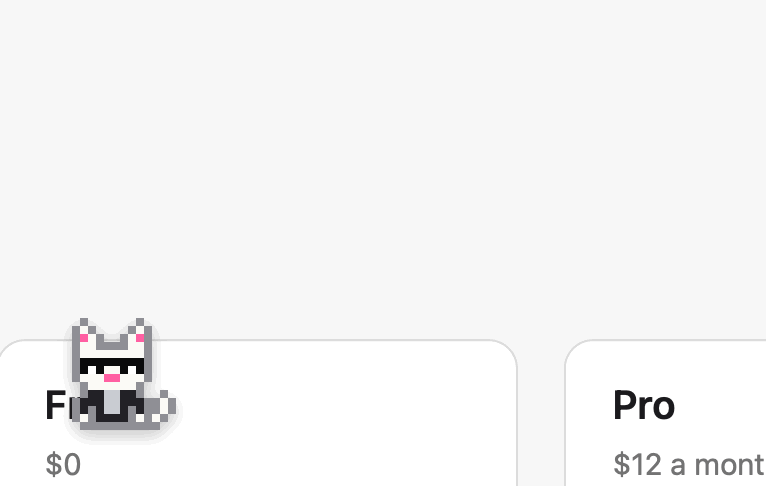
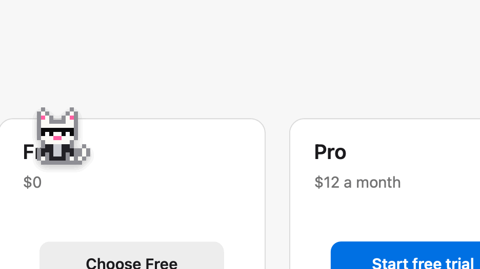
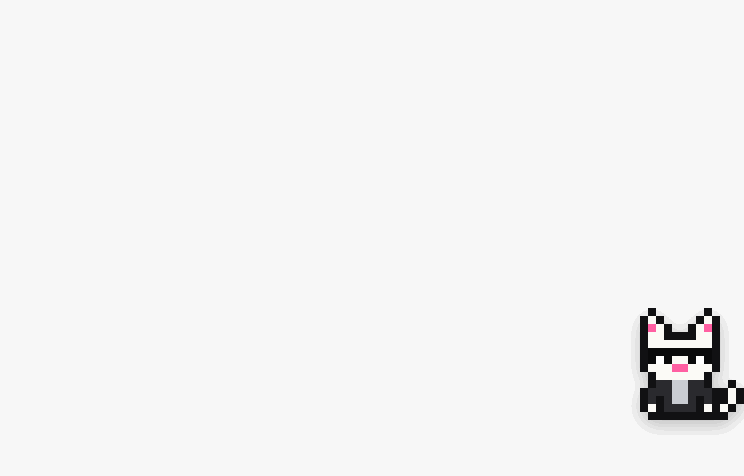
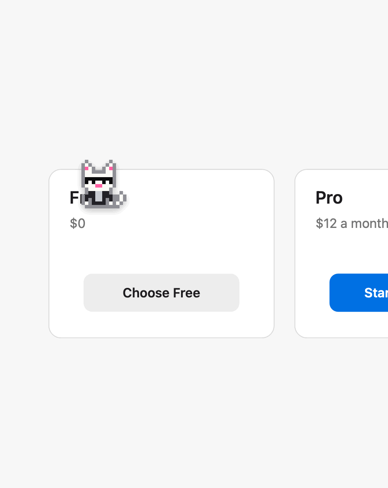
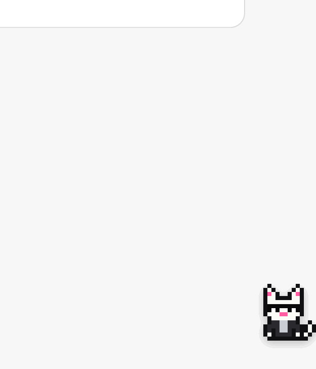
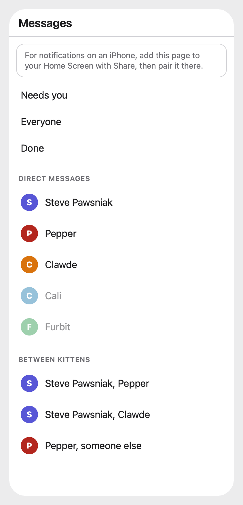

# Kitty Litter

The home of Shades, a cat in sunglasses that lives on your Mac. Ask it about whatever's on your screen, point at something broken and have an agent fix it, and keep an eye on your agents without switching windows.


It's early, and it runs its agents through [T3 Code](https://t3.codes), so you'll need that running.

## What it does

The recordings here come from demo mode, with made-up kittens and a pretend pricing page, and Shades draws each frame from its own windows.

**Ask.** Press ⌥Space or click the cat, and ask anything. It looks at your screen at that moment and answers in a bubble, usually in about 10 seconds, though a model can occasionally take much longer. Good for "how do I start problem 3?" or "what does this error mean?" Ask where something is, like "where's the export button?", and the cat runs over and sits on it. It only points, and never clicks. If it can't find the spot, it says so.

<p> </p>

**Rewrite what you've selected.** Select some text, ask the cat to "tighten this" or "make it friendlier", and the rewrite shows in the bubble with **Replace**. Nothing in your app changes until you press it. Then it goes in place of your selection, as long as the same text is still selected, and Command-Z takes it back. That works in apps whose text fields allow it, such as Notes, Mail and TextEdit. Anywhere else, or if the selection has moved, the rewrite is copied for you to paste instead.

**Drop onto the cat.** Drag a PDF, a picture or a link onto the cat, and the Ask box opens with it. Ask about it, or just press Return for a summary. It goes through the router like any question, so a syllabus can go to one kitten and a job posting to another. Only what you dropped goes with your words, with no look at your screen.



**Fix what I'm looking at.** Press ⌃⌥F and drag a box around whatever's wrong. Say what's wrong, or just press Return. A frontier agent works out which of your projects it is, and fixes it in its own worktree, so your checkout stays untouched.

**Talk and dictate.** Hold right Option to talk to the cat. Hold Fn to dictate into any app, and your rambling comes out as clean text: fillers gone, self-corrections applied. Speech recognition and cleanup both run on your Mac.


**Watch your agents.** The cat sleeps when nothing's running, and is up and about when agents are working. When a session ends, it tells you how it went in two or three sentences, and **Open** shows the whole thread in Messages, where you can reply. Only a thread Messages doesn't follow, such as one you started in T3 yourself, opens in T3 instead, unless you set **Open threads** to **In T3** in Settings. When an agent has a question, it shows you the question and your options. When one needs permission, the cat comes over with the exact command, so you can allow or deny it without leaving what you're doing. Shift-click the cat to see all your kittens and which are working, need you or are idle. A kitten can send its reports to Messages instead, where they wait in Activity: what shipped, what you need to decide, and a way to reply to any of it.

<p> </p>

**Messages.** Press ⌃⌘B from anywhere, or choose Messages from the cat's menu, for one window with everything your kittens need from you, so you rarely have to open T3. It's laid out like Slack. **Activity** at the top has approvals, questions, reports waiting on a decision, what shipped, and what each kitten is on, with a count of what's waiting. When something new needs you, a macOS notification says who and what kind, and clicking it opens the thread it's about. Turn on **Also when a session finishes** in Settings for one when a session finishes too. **Notifications**, in each channel's header, says what that channel tells you on this Mac and on your phone: **Everything**, **Only when it needs you** for approvals, questions, decisions and failures, or **Nothing**. **Mute** quiets it everywhere, with the header saying Muted, and keeps what you'd picked for when you unmute it. **Threads** lists every thread you've written in, unread ones first. Under **Channels**, **#general** goes through the router, the same as the Ask box: when the cat answers itself, its answer follows yours, and when your words start work, for a kitten or the frontier agent, that work is a thread under your message. Name a kitten with an @, such as `@steve-pawsniak`, and your words go straight to it instead. Each kitten has a channel of its own, such as #steve-pawsniak, bold when it's finished something you haven't seen, with a red count of what it's waiting on you for. Every T3 session is a thread: its first message, then a reply bar with who's replied, how many times and when, and clicking it opens the thread beside the channel. A red **New** line shows where what you haven't seen starts, with a way up to it when it's above what you can see, and **Mark unread** on a message keeps it to come back to. What you type in a thread's pane goes only into that thread, and **Also send to #channel** under it shows your reply in the channel too. Each place and thread keeps its own draft, as Slack's do, so what you've typed stays where you typed it when you move away. What you send says **Sending...** until T3 has it, and if it never gets there, it says why under it, with **Try again** to send it again. Typing in a kitten's channel starts a new thread. **Shades**, under Direct messages, keeps your talks with the cat, without the screen that went with them, and stays on your Mac. That includes work you start with the cat outside Messages, such as a Fix or a hand-off from the Ask box, which you can follow up right there. To follow one of those from your phone, press **Show on phone** at the top of its thread, and it's under Shades on your phone too, with only your words and the agent's replies. Type in the DM itself to talk to the cat, without a look at your screen. #general, the DM and replies also sent to a channel stay where they were when Shades restarts, and scrolling back past the top of a channel or the DM loads its older threads. Messages are bubbles, yours on the right and each kitten's on the left in its own colour. To have your own picture beside yours, the way each kitten has its cat, run the app once with `--picture` and a photo, such as `/Applications/Shades.app/Contents/MacOS/Shades --picture ~/Pictures/me.jpg`. It keeps a small copy, and from its next start draws it round, in Messages and on your phone. Run it again to change it. Once you've clicked into it, it takes the keys T3 Code, the Claude app and Slack do, such as ⌘⇧[ and ⌘⇧] for the thread above or below, ⌥↑ and ⌥↓ for the place above or below, ⌘[ and ⌘] for back and forward, ⌘K to jump anywhere by name, and ⌘F to find a message by its words, in what Messages has read and, a moment later, older threads T3 has, landing right on it. Your phone has the same **Search**, over what it can see. Nothing you search for is written down. **⌘/ Shortcuts**, beside Theme, lists them all. Messages show the markdown they were written in, with code blocks, lists and tables, **Copy** on each code block, and a pull request's address as a chip with its state. Pressing a link shows where it goes first, and only **Open** opens it, so nothing in a message can open anything by itself. Press in any message to select its words, and copy them with ⌘C or a right-click. **React**, over a message when you hover, or a tap on its words on your phone, marks it with 👍, ✅, 👀, ❤️, 😂 or 🎉. A reaction stays with Messages and never reaches an agent. To send a photo, a picture or a PDF with your words, drop it onto the box or anywhere in a place, or paste it. It goes where a file dropped onto the cat would, and where it can't, such as to a kitten that doesn't see your screen, nothing goes and Messages says why under it. Nothing typed in Messages looks at your screen, and the window never shows up in a screenshot. **Theme**, at the bottom of the sidebar, dresses Messages and its phone page in a theme T3 Code, Cursor, VS Code or iTerm2 already has, or in any theme file you drop onto the window. Your messages take a tint of the theme's accent, and each kitten keeps its own colour. Turn on **Messages on my phone** in Settings, and it's in your phone's browser too, over your Tailscale network, laid out like Slack's phone app with each kitten as its own pixel cat, the same buttons and the same notifications, and 📎 and 📷 beside the box for attaching a photo or PDF, or taking a photo. See [On your phone](docs/kittens.md#on-your-phone).


On your phone, the same Messages over your tailnet:



**Do Not Disturb.** Choose Do Not Disturb from the cat's menu or the menu bar, or press it at the bottom of Messages' sidebar, and nothing pops up: no bubble for a report, a reply, a question, an approval or anything the cat would say by itself, no macOS notification and no notification on your phone. The cat curls up asleep, the menu item has a check, and Messages says Do Not Disturb is on, so you know why it's quiet. It stays on through a restart until you turn it off. Anything you start yourself, such as asking the cat, still answers as usual. Nothing waiting on you is answered or dropped for being ignored. When you turn it off, the cat says once what came in, such as "While you were away: 2 replies, 1 approval", and **Open** shows all of it at the top of Activity, in the order it came, each with its usual buttons. It stays there until you've looked and closed Messages. What was held back isn't sent late.

**Settings.** Choose Settings from the cat's menu, or press **Settings** at the bottom of Messages' sidebar or ⌘, in Messages, for every setting in one place, a page at a time. **Agents** has the models and how much each may do by itself. **Voice** has the keys you hold to talk and dictate, and words to listen for. **Notifications** has Do Not Disturb, **Also when a session finishes**, and every channel with what it tells you, using the same menu as its header. **Messages** has the theme, and the font and text size of Messages on your Mac: the system's, its serif, rounded or monospaced faces, or any font on your Mac, each shown in itself. It also has whether **Open** shows a thread in Messages or in T3, and Messages on your phone. **Privacy** has the apps nothing is captured from. A change takes as you make it, there's nothing to save, and **Open the file** shows the settings file, which stays easy to edit by hand. Like the cat's other windows, it never takes your app out of the front.

## How the work gets routed

There's no list of projects to maintain. Shades acts as one router in front of your agents. Everything you say goes to one model that can see your kittens and your recent T3 sessions, and it does one of four things:

- **Answers** if it can.
- **Sends it to a session** if it carries on from one, such as a follow-up to what Opus just reported. Your exact words go there, never a paraphrase, and that session keeps its own model and permissions.
- **Gives it to a kitten** if it's in a specialist's area.
- **Starts new work** if nothing has the context, saying so as it does. Fix always starts new work.

A correction you make along the way also reaches the kitten that owns the fact, as [docs/kittens.md](docs/kittens.md#corrections) explains.

Agents with full access get your words but not your screen, so text on a page can't reach an agent that's allowed to do anything. When your words point at your screen, like "read this thread" with no link, and the screen isn't going with them, the cat says so as it passes them on, so you can send the link or paste the text. That's when a kitten or session doesn't get your screen, when nothing could be captured or the app is private, and when Messages starts a thread or passes your words on, since it never sends your screen. A reply straight to a thread is only what you typed, so it doesn't warn. In a follow-up it only says so if your words name something like a thread or an article, because "this" there usually means the session's own work. Something you drop onto the cat counts as your screen, since a picture of it is a screenshot, so it goes only where your screen may. Where it can't, the cat says so and sends nothing, except that a correction in your words still reaches the kitten that owns it, without the file. Only when the front door itself can't take the file does nothing go at all.

The router only replies, and Shades does the rest. It runs in a folder of its own where it can only search the web, so it can't read your files, message or start threads, run commands or write files, and can't pass your screen on by itself. Only Claude reads that folder, so the front door has to be a Claude model, and on any other the cat won't take questions.

The frontier agent starts with no project, and finds the right one from what you said and what's on your screen, reading READMEs when a project's name isn't its folder name. For code changes it starts a new thread in that project's worktree. Research and questions it just answers.

The models are settings you can change. Opus 5.5 on xHigh is the default for both the front door and real work, and GPT-6.1 Sol on low writes the summaries.

## Install

You need an Apple Silicon Mac on macOS 14 or later, Xcode 16 or later, and T3 Code running.

```bash
git clone https://github.com/rohankumarrrr/kitty-litter
cd kitty-litter
scripts/make-dev-cert.sh   # see below
scripts/install.sh
```

The first launch does a few things:

- **Asks for permissions:** Screen Recording, Accessibility, Input Monitoring, the microphone, and scripting your browser. Turn them on, then choose **Restart** from the cat's menu.
- **Connects to T3 Code** by itself, with nothing to click.
- **Downloads about 1.2 GB of speech models.** The cat shows the progress. Asking by typing works in the meantime.

macOS ties permissions to an app's signature. Without a signing certificate, every rebuild has a new signature, so macOS forgets them. `scripts/make-dev-cert.sh` makes a local self-signed certificate that fixes this, and adds it to your keychain, so read the script first. When macOS asks whether codesign can use the key, choose **Always Allow**. `scripts/install.sh` won't replace a working app with an ad hoc build unless you pass `--ad-hoc`.

Two settings are worth changing:

- **To dictate with Fn:** set **System Settings > Keyboard > Press 🌐 key to** to **Do Nothing**. Otherwise macOS can act on the key too. You can also pick another key in Settings.
- **To read page text in your browser:** turn on **View > Developer > Allow JavaScript from Apple Events**. Without it, the cat still gets the address and a screenshot.

To see it without T3, permissions or a microphone, run `swift run shades --demo`. A demo, or a copy trying a flow out with `--ask`, `--hand-off` or `--fix`, takes none of the cat's shortcuts, so it never stops them working in the copy you've installed.

## Privacy

- **It looks only when you ask:** pressing a key or clicking the cat takes one snapshot. Nothing runs in the background.
- **What leaves your Mac:** your question, a screenshot, the app and window names, the address, and any selected or page text go to the model you've chosen, through T3 Code. The router also gets the labels and places of the buttons, fields and text in the front window and the menu bar, so it can point at one, but never what's typed into a field. T3 Code keeps them with the thread. Your voice stays on your Mac, and only the resulting text is sent. When a session ends, its final report goes to the summary model, which may be a different provider from the one that ran the session.
- **Private apps stay private:** password managers are on a list you can edit on Settings' Privacy page, and incognito windows in Chromium browsers are skipped. Nothing is captured while they're in front. Background windows can still show up in a screenshot, and Safari's private windows mostly can't be detected.
- **Screen text is treated as data:** the agents are told it's never instructions, and they run in T3's `auto` mode rather than with full access. That lowers the risk of a page steering an agent, but doesn't remove it. For that reason, Allow is never a default in the cat's approval requests.
- **What you drop:** a PDF's text, a picture or a link, plus the file's name and where it is on your Mac, go to the router and whoever it picks. A photo or file you attach in Messages, on your Mac or your phone, counts the same way, and is kept only in memory until it's sent. A kitten that doesn't see your screen gets nothing you drop, with the same exception as your screen: a new thread titled with its name.
- **Saved screenshots:** agents get a copy to open, kept in `~/Library/Application Support/shades/captures` for a day.
- **Agents run as you:** they can open anything you can, including the copies of your screen that T3 Code, Claude and Codex keep. If T3 Code has Screen Recording or Accessibility, so does every agent it runs, whatever the privacy list says. Shades has its own permissions and doesn't need T3 Code to have them. [Keeping a kitten off your screen](docs/kittens.md#keeping-a-kitten-off-your-screen) says what can be enforced and what can't.
- **Notifications:** they say only who needs you and for what, such as "Pepper needs an approval", or if you turn them on, who finished, such as "Pepper finished", and never what was asked or said, since Notification Center keeps its own copy and can show it on the lock screen. On a paired phone they're encrypted for that phone alone, so its push service sees only that Shades sent something.
- **Your phone:** Messages on your phone is off until you turn it on. Then the page is on your Tailscale network, and only a phone you've paired with a code from your Mac gets past it. What it shows goes to your phone's browser, and Shades keeps only a hash of each phone's key, in your Keychain. Turning it off unpairs every phone. Your DM with the cat stays off it, except a thread of the cat's own work you've pressed **Show on phone** for on your Mac, and even then only your words and the agent's replies go, never your screen, the thread's title or a file's name.
- **Your picture:** if you give Messages one, a small copy is kept in `~/Library/Application Support/shades/picture.jpg`, and deleting it goes back to your blue square. It's only drawn, in Messages and on a paired phone, and never goes to T3 or an agent.
- **Do Not Disturb:** what came in while it was on is saved with the inbox only as IDs, such as a thread's or an approval's, and read again from T3 when you catch up. The cat's own lines aren't saved at all.
- **Unread:** what you've seen in Messages, where each thread's New line goes and what you marked unread are saved with the inbox only as IDs, never what was said.
- **The inbox:** what's in it is saved only on your Mac, in `~/Library/Application Support/shades/inbox.json`, which only you can read. A reply is your words and nothing else. It never looks at your screen.

## Kittens

A kitten is a specialist with a folder of its own: its instructions and what it knows about you, so you don't have to explain yourself each time. Add a folder to `~/kittens`, add it to T3 as a project, and Shades starts sending it things. A kitten that looks after an app can work in that app's T3 project instead. Normally you just see Shades, and Shift-clicking him shows the rest. Messages gives each one a channel, with each of its sessions as a thread, shows what it's on, and lets you answer any of it. Add `"inbox": true` to a kitten that sends you a lot, and its reports wait in one place, which keeps them across a restart. See [docs/kittens.md](docs/kittens.md).

## Changing Shades by asking Shades

You can set up a kitten called Clawde whose area is the system itself, so "Steve should stop doing that" or "the bubble's too wide" goes through Shades like anything else. Changes to a kitten's instructions apply straight away, and changes to the app come back as a pull request with its proof, which merges once it's proven and installs when you say "ship it". See [docs/kittens.md](docs/kittens.md#a-kitten-for-the-system-itself).

## When something goes wrong

Choose **Check Myself** from the cat's menu, and it goes through its signature, permissions, T3 Code and kittens, and tells you what's wrong and what to do. If another copy of Shades has its shortcuts, it says which one to quit. The running app also writes that to `~/Library/Application Support/shades/health.json`, for agents to read.

`scripts/install.sh` only replaces the running app with a properly signed build. It keeps the old copy, and puts it back if the new one doesn't come up. To go back by hand, run `scripts/install.sh --rollback`.

## How it's built

| Module | What it does |
|---|---|
| `ShadesCore` | Shared types, contracts, prompts and kittens |
| `Shades` | The cat, its windows and the flows |
| `ShadesContext` | Screen capture, selected text, browser pages, what the cat can point at, the region picker |
| `ShadesT3` | The T3 Code client. See [docs/t3-integration.md](docs/t3-integration.md) |
| `ShadesVoice` | Hold keys, the microphone, speech and cleanup. See [docs/voice.md](docs/voice.md) |

T3 Code's server API is internal and still in beta, so a T3 update can break Shades. If it does, the cat says so, and `swift run probe-t3` shows which part stopped working.

See [docs/ROADMAP.md](docs/ROADMAP.md) for what might come next.

## Credits

- [myCat](https://github.com/yumiaura/myCat) by yumiaura, the desktop cat that inspired this one.
- Lauren Tan's [pstack](https://github.com/cursor/plugins/tree/main/pstack) and chief-of-staff setup, which inspired the kittens and how they work, as [adapted for T3](https://github.com/chhoumann/t3-pstack) by Christian Bager Bach Houmann.
- [Ponytail](https://github.com/DietrichGebert/ponytail) by Dietrich Gebert, for keeping changes small.
- [oneko.js](https://github.com/adryd325/oneko.js) and the original Neko, for how the cat behaves.
- [FluidAudio](https://github.com/FluidInference/FluidAudio), for on-device speech.
- [Parakeet Ultra](https://huggingface.co/moondream/parakeet-ultra) and NVIDIA's Parakeet (CC BY 4.0), the speech models.
- **S1-mini by Superwhisper**, the model that cleans up dictation, on [llama.cpp](https://github.com/ggml-org/llama.cpp). See the [licences](docs/voice.md#licences).

## License

[MIT](LICENSE), which covers the code. The downloaded models keep their own licences.
